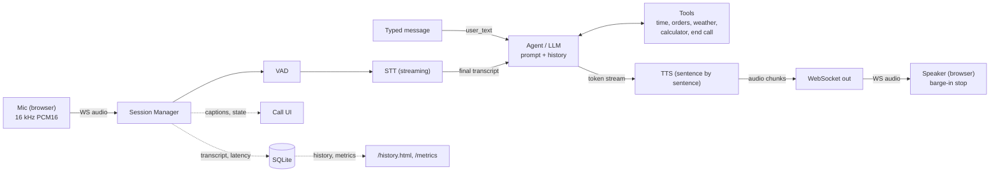

# Voice Agent MVP

[](https://github.com/Anu27n/voice-agent-mvp/actions/workflows/ci.yml)

A voice agent you talk to in real time from a web page. It listens, transcribes
with streaming speech-to-text, decides how to respond with Claude (calling tools
when needed), and speaks the reply back with streaming text-to-speech. You can
interrupt it mid-sentence, type instead of talking, and it remembers the
conversation until you or it hangs up.

**Core (the assignment)**

- **Streaming end to end.** Live captions, token streaming, and sentence-by-sentence TTS.
  The agent starts talking while the rest of the reply is still being generated.
- **Barge-in.** Talk over the agent and playback stops after 160 ms of detected speech.
  Detection learns the level of the agent's own echo, so speakers don't cause false
  interruptions. Your words become the next turn, and only what you actually heard is
  kept in the history.
- **Per-stage latency** (VAD, STT, LLM, TTS, total) for every turn. It shows live in the UI,
  is stored in SQLite, and is summarized by a benchmark and a report script.
- **Pluggable providers.** Deepgram STT, Claude, Deepgram or ElevenLabs TTS, plus offline
  mocks. Swapping one is a config change.
- **Error handling** for every failure case in the spec. Fallback lines, timeouts, a goodbye
  on silence or max duration, and clean session end on disconnect.

**Bonus features**

- **Tools.** Current time (in the caller's own time zone), order status (mock service), live
  weather anywhere (Open-Meteo, no key needed), and an exact calculator for totals, tips and
  percentages.
- **The agent hangs up.** Say "thanks, that's all" and it says goodbye, then ends the call
  once the goodbye has played. Interrupting the goodbye keeps the call open.
- **Type or talk.** Send typed messages during a call, which also interrupts the agent, or
  start a text-only call when no microphone is available.
- **Call history page** (`/history.html`). Recent calls, transcripts with tool calls,
  per-turn latency, a latency summary, and a Markdown transcript download.
- **Observability.** Prometheus `/metrics`, `/metrics/summary` (JSON), and JSON logs
  (`LOG_FORMAT=json`).
- **Speech-safe replies.** Markdown, list markers, emoji and URLs are cleaned out before TTS.
- **Ready for a public URL.** Providers switch automatically (real when keys are set, demo
  mode otherwise). There's an optional access code, a concurrent-call limit, a Docker image,
  and a one-file Render blueprint.
- **Controls.** Mute, keyboard shortcuts (<kbd>Esc</kbd> end, <kbd>M</kbd> mute,
  <kbd>/</kbd> type), and a mic level meter.

The full design (flow, event schema, interfaces, barge-in, latency definitions)
is in [docs/DESIGN.md](docs/DESIGN.md).

## Architecture



One asyncio pipeline runs per call (`voice_agent/pipeline.py`). Every vendor sits
behind an interface in `voice_agent/providers/base.py`.

## Quick start

Requires Python 3.11+ and a recent Chrome, Edge or Firefox.

```bash
python -m venv .venv
```

Activate it (`source .venv/bin/activate`, or `.venv\Scripts\activate` on Windows), then:

```bash
pip install -e ".[dev]"
```

```bash
python -m voice_agent
```

Open <http://127.0.0.1:8000>, click **Start Call** and allow the microphone.

**Without API keys** the app runs in demo mode, and the page says so. Speech
recognition is scripted: each time you speak it "hears" the next line of
`MOCK_STT_SCRIPT`. Replies come from a small rule-based stand-in for the LLM that
uses the real tools, and the voice is a synthetic hum. Typed messages skip the
script, so typing "what's the weather in Tokyo?" gets a real answer.

**With real providers**, copy the example config and add your keys:

```bash
cp .env.example .env
```

Set `ANTHROPIC_API_KEY` and `DEEPGRAM_API_KEY` in `.env`. Providers default to
`auto`, which picks Deepgram and Claude as soon as their keys are present.
Browsers only allow the microphone on `localhost` or over HTTPS.

## Deploy to Render

The repo includes a [Render Blueprint](render.yaml), which builds the
`Dockerfile`, runs a health check on `/healthz`, and uses the free plan.

1. In the Render dashboard choose **New** -> **Blueprint**, connect GitHub, and pick this
   repository.
2. Fill in the prompted values. `ANTHROPIC_API_KEY` and `DEEPGRAM_API_KEY` switch from demo
   mode to real providers; leave them empty for a demo. Set `ACCESS_CODE` to keep strangers
   from spending your API credits; the page asks visitors for it.
3. Click **Apply**. Render builds the image and serves it at `https://<name>.onrender.com`,
   with HTTPS and WebSockets, which the microphone needs.

Free instances sleep after 15 minutes idle; the first request then takes about 30
seconds. The SQLite call history lives on the instance's disk, so a redeploy resets
it. The blueprint deploys `main` and redeploys on every push.

Elsewhere, run the image anywhere Docker runs:

```bash
docker build -t voice-agent .
```

```bash
docker run -p 8000:8000 -e ANTHROPIC_API_KEY -e DEEPGRAM_API_KEY voice-agent
```

## Configuration

All settings are environment variables (or `.env`). The main ones:

| Variable | Default | Meaning |
| --- | --- | --- |
| `STT_PROVIDER` / `LLM_PROVIDER` / `TTS_PROVIDER` | `auto` | `auto` (real if its key is set, else `mock`), `deepgram`, `anthropic`, `elevenlabs`, `mock`, or `package.module:Class` |
| `ANTHROPIC_API_KEY` | | Claude API key |
| `DEEPGRAM_API_KEY` | | Deepgram key (STT and TTS) |
| `ELEVENLABS_API_KEY` / `ELEVENLABS_VOICE_ID` | / `21m00Tcm4TlvDq8ikWAM` | ElevenLabs TTS |
| `LLM_MODEL` | `claude-opus-5-5` | Claude model; `claude-haiku-5-5` for the lowest latency |
| `LLM_EFFORT` | `low` | `low` / `medium` / `high`: reasoning depth vs. time to first token |
| `LLM_FALLBACKS` | `default` | server-side refusal fallback; `off` to disable |
| `SYSTEM_PROMPT` / `SYSTEM_PROMPT_FILE` | built in | the agent's instructions |
| `PROMPT_VERSION` | hash of the prompt | stored with each session |
| `VAD_SILENCE_MS` | `600` | trailing silence that ends an utterance |
| `VAD_START_MS` | `100` | sustained voice needed to start one |
| `VAD_MIN_UTTERANCE_MS` | `250` | shorter voiced segments are ignored as noise |
| `VAD_THRESHOLD_DB` | `-45` | absolute level (dBFS) a frame must exceed to count as voice |
| `BARGE_IN_MIN_MS` | `200` | speech that cancels a reply still being generated |
| `SILENCE_TIMEOUT_S` | `120` | end the call after this much silence |
| `MAX_CALL_DURATION_S` | `600` | hard call limit |
| `STT_TIMEOUT_S` / `LLM_TIMEOUT_S` / `TTS_TIMEOUT_S` / `TOOL_TIMEOUT_S` | `4` / `10` / `5` / `5` | per-stage timeouts |
| `ENABLE_WEATHER` | `true` | the `get_weather` tool (calls Open-Meteo) |
| `ALLOW_AGENT_HANGUP` | `true` | the `end_call` tool |
| `DEFAULT_TIMEZONE` | server local | time zone for `get_current_time` when the caller's isn't known |
| `ACCESS_CODE` | | when set, the API and the socket require it (`X-Access-Code` header or `code` query) |
| `MAX_ACTIVE_CALLS` | `10` | `POST /sessions` answers 429 beyond this |
| `TTS_SAMPLE_RATE` | `24000` | agent audio sample rate |
| `DEEPGRAM_STT_MODEL` / `DEEPGRAM_TTS_MODEL` | `nova-3` / `aura-2-thalia-en` | Deepgram models |
| `HOST` / `PORT` / `DB_PATH` | `127.0.0.1` / `8000` / `data/voice_agent.db` | server |
| `LOG_LEVEL` / `LOG_FORMAT` | `INFO` / `text` | `LOG_FORMAT=json` for one JSON object per line |

Every field of `voice_agent/config.py:Settings` can be set the same way (upper-case name).

### Swapping a provider

Switching TTS from Deepgram to ElevenLabs is configuration only:

```bash
TTS_PROVIDER=elevenlabs ELEVENLABS_API_KEY=... python -m voice_agent
```

A new vendor is one class implementing `STTProvider`, `LLMProvider` or `TTSProvider`
(see `voice_agent/providers/elevenlabs.py` for a ~50-line example). Point the
setting at it, for example `TTS_PROVIDER=my_pkg.tts:MyTTS`. The pipeline never changes.

## API

| Endpoint | |
| --- | --- |
| `POST /sessions` | creates a session (optional body `{"timezone": "Asia/Kolkata"}`); returns `session_id` and the audio formats; 429 when at `MAX_ACTIVE_CALLS` |
| `WS /ws/voice?session_id=...` | binary audio both ways plus JSON events, including `user_text` for typed messages |
| `GET /sessions?limit=20` | recent calls: turns, median latency, how they ended |
| `GET /sessions/{id}` | the saved transcript, per-turn metrics and errors |
| `GET /sessions/{id}/transcript.md` | the same call as a Markdown document |
| `GET /metrics/summary?last=20` | median and p90 per stage over recent turns |
| `GET /metrics` | Prometheus text format: calls, turns, barge-ins, errors, stage latency |
| `GET /healthz` | providers, demo mode, active calls (never needs the access code) |

The event list and payloads are in [docs/DESIGN.md section 6](docs/DESIGN.md#6-api-and-websocket-events).

## Tests

```bash
pytest
```

- unit tests for state transitions, VAD, sentence splitting, every tool (including
  calculator safety and mocked weather responses), the agent's history rules,
  metrics, storage, config, and every adapter (mocked HTTP, a fake Anthropic
  client, and a local fake Deepgram WebSocket server);
- pipeline tests for each call flow and failure case: barge-in, fallbacks,
  timeouts, disconnect, noise, typed messages, and the agent hanging up;
- API tests for the access code, call limit, history, transcripts and metrics;
- an integration test that starts the server and streams a recorded WAV
  (`tests/fixtures/two_turns.wav`) over a real WebSocket through the whole pipeline,
  plus the benchmark itself.

With real keys in the environment, `pytest -m live` also checks the Deepgram and
Claude adapters against the live APIs. `python scripts/make_fixture.py`
regenerates the WAV (Windows speech synthesis).

CI (GitHub Actions) runs `ruff` and the test suite on Linux (Python 3.11 and 3.12)
and Windows. It also builds the Docker image and smoke-tests the container, on
every push and pull request.

## Latency report

Every turn's stage timings are stored. To produce the 20-turn report without
talking for 20 turns, run the benchmark against a running server. It acts as a
caller, replaying the recorded questions in real time:

```bash
python -m voice_agent.benchmark --turns 20 --out docs/latency-report.md
```

It prints each turn as it goes, then the median and p90 per stage (VAD end, STT
final, LLM first token, TTS first audio, total) and checks the median total against
the 1.5 s budget. Run it with the real providers configured for numbers worth
reporting. Add `--url https://<your-app>.onrender.com` to benchmark a deployment.

For calls you made yourself, use `python scripts/latency_report.py --last 20`, or
open `/history.html`.

## Project layout

```
voice_agent/
  main.py            HTTP + WebSocket endpoints, access code, static client
  pipeline.py        per-call orchestration: VAD, utterances, replies, barge-in, typed turns, hang-up
  session.py         session manager
  state.py           call state machine
  vad.py             energy VAD
  agent.py           tool loop and append-only history
  sentences.py       token stream -> sentences
  speakable.py       strips markdown, emoji and URLs before TTS
  tools.py           tool executor; time, orders, calculator, weather, end_call
  timeline.py        what the caller heard, for barge-in
  metrics.py         per-turn timing, median / p90
  report.py          latency report, Markdown transcripts, Prometheus text
  benchmark.py       replays recorded speech into a running server (python -m voice_agent.benchmark)
  store.py           SQLite persistence
  config.py          settings from the environment, provider auto-selection
  providers/         interfaces, registry, anthropic, deepgram, elevenlabs, mock
web/                 call page (index.html, app.js), history page (history.html, history.js),
                     common.js, mic-worklet.js, styles.css
scripts/             latency report, fixture generator
tests/               unit, pipeline, API, integration and live tests
docs/DESIGN.md       design doc
Dockerfile           production image (non-root, health check, JSON logs)
render.yaml          Render Blueprint
.github/workflows/   CI: lint, tests on Linux and Windows, Docker build and smoke test
```

## Acceptance criteria

| Criterion | Where |
| --- | --- |
| 5+ turn conversation with memory | `test_five_turn_conversation_remembers_and_uses_tools`; history in `agent.py` |
| Median end of speech to first audio <= 1.5 s | measured per turn; `python -m voice_agent.benchmark --turns 20` with real providers |
| Live partial and final captions | `transcript_partial` / `transcript_final`; partial line in the UI |
| Barge-in stops audio within ~300 ms | client stops playback after 160 ms of speech; server cancels LLM and TTS (`test_client_barge_in_...`) |
| Sample tool invoked when relevant | five tools; tool chips in the transcript; `test_more_tools.py` |
| All section-6 failure cases | `tests/test_pipeline.py`, plus the client's mic-denied and disconnect handling |
| Transcript and latencies retrievable by session_id | `GET /sessions/{id}`, `/sessions/{id}/transcript.md`, `/history.html` |
| Swap a provider with config + adapter only | `test_swapping_tts_is_configuration_only`, `test_custom_adapter_by_dotted_path_...` |
| Unit tests (mocked) + recorded-audio integration test | `tests/` |
| README with setup, env vars, diagram, how to run | this file |

## Recording the demo

With real keys, open the page and do a multi-turn call:
1. Ask the time and the weather somewhere.
2. Ask about order `A1001`.
3. Interrupt a long answer ("tell me a story about...") mid-sentence.
4. Finish with "thanks, that's all", so the agent hangs up.

Then open `/history.html` for the transcript, or run the benchmark for the latency
report.

## Limitations

- Barge-in and VAD are energy-based. Barge-in adapts to the agent's echo, and both
  work well in a normal room; a neural VAD would be the upgrade for very noisy rooms.
- When to return to listening is estimated from the audio sent, not reported
  by the client.
- One process with SQLite. The access code is a shared secret, not user accounts.
  English only. Horizontal scaling, telephony, real auth and multi-language are out
  of scope, per the spec.
