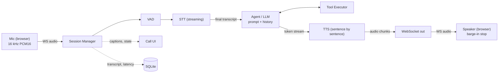

# Voice Agent MVP

A voice agent you talk to in real time from a web page. It listens, transcribes
with streaming speech-to-text, decides how to respond with Claude (calling tools
when needed), and speaks the reply back with streaming text-to-speech. You can
interrupt it mid-sentence, and it remembers the conversation until you hang up.

- **Streaming end to end.** Live captions, token streaming, and sentence-by-sentence TTS.
  The agent starts talking while the rest of the reply is still being generated.
- **Barge-in.** Talk over the agent and playback stops after 160 ms of detected speech.
  Your words become the next turn, and only what you actually heard is kept in the history.
- **Tool calling.** `get_current_time` (any time zone) and `get_order_status` (mock order
  service). Failures are reported back to the model, which explains them.
- **Per-stage latency** (VAD, STT, LLM, TTS, total) for every turn. It shows live in the UI,
  is stored in SQLite, and gets summarized by a report script.
- **Pluggable providers.** Deepgram STT, Claude, Deepgram or ElevenLabs TTS, plus offline
  mocks. Swapping one is a config change.
- **Error handling** for every failure case in the spec. Fallback lines, timeouts, a goodbye
  on silence or max duration, and clean session end on disconnect.

The full design (flow, event schema, interfaces, barge-in, latency definitions)
is in [docs/DESIGN.md](docs/DESIGN.md).

## Architecture



One asyncio pipeline runs per call (`voice_agent/pipeline.py`). Every vendor sits
behind an interface in `voice_agent/providers/base.py`.

## Quick start

Requires Python 3.11+ and a recent Chrome, Edge or Firefox.

```bash
python -m venv .venv
```

Activate it (`source .venv/bin/activate`, or `.venv\Scripts\activate` on Windows), then:

```bash
pip install -e ".[dev]"
```

### Try it offline (no API keys)

With no configuration, every provider is a mock: scripted transcripts, a small
rule-based agent that uses the real tools, and a soft synthetic voice.

```bash
python -m voice_agent
```

Open <http://127.0.0.1:8000>, click **Start Call** and allow the microphone. Each
time you speak, the mock STT "hears" the next line of its script (see
`MOCK_STT_SCRIPT`), so you can exercise turns, tool calls, barge-in and the latency
panel without any accounts.

### Use real providers

Copy the example config and add your keys:

```bash
cp .env.example .env
```

Set `ANTHROPIC_API_KEY` and `DEEPGRAM_API_KEY` in `.env` (it already selects
`deepgram` / `anthropic` / `deepgram`), then run `python -m voice_agent` again.
Browsers only allow the microphone on `localhost` or over HTTPS, so serve
anything non-local behind TLS.

## Configuration

All settings are environment variables (or `.env`). The main ones:

| Variable | Default | Meaning |
| --- | --- | --- |
| `STT_PROVIDER` / `LLM_PROVIDER` / `TTS_PROVIDER` | `mock` | `deepgram`, `anthropic`, `elevenlabs`, `mock`, or `package.module:Class` |
| `ANTHROPIC_API_KEY` | | Claude API key |
| `DEEPGRAM_API_KEY` | | Deepgram key (STT and TTS) |
| `ELEVENLABS_API_KEY` / `ELEVENLABS_VOICE_ID` | / `21m00Tcm4TlvDq8ikWAM` | ElevenLabs TTS |
| `LLM_MODEL` | `claude-opus-5-5` | Claude model; `claude-haiku-5-5` for the lowest latency |
| `LLM_EFFORT` | `low` | `low` / `medium` / `high`: reasoning depth vs. time to first token |
| `LLM_FALLBACKS` | `default` | server-side refusal fallback; `off` to disable |
| `SYSTEM_PROMPT` / `SYSTEM_PROMPT_FILE` | built in | the agent's instructions |
| `PROMPT_VERSION` | hash of the prompt | stored with each session |
| `VAD_SILENCE_MS` | `600` | trailing silence that ends an utterance |
| `VAD_START_MS` | `100` | sustained voice needed to start one |
| `VAD_MIN_UTTERANCE_MS` | `250` | shorter voiced segments are ignored as noise |
| `VAD_THRESHOLD_DB` | `-45` | absolute level (dBFS) a frame must exceed to count as voice |
| `BARGE_IN_MIN_MS` | `200` | speech that cancels a reply still being generated |
| `SILENCE_TIMEOUT_S` | `120` | end the call after this much silence |
| `MAX_CALL_DURATION_S` | `600` | hard call limit |
| `STT_TIMEOUT_S` / `LLM_TIMEOUT_S` / `TTS_TIMEOUT_S` / `TOOL_TIMEOUT_S` | `4` / `10` / `5` / `5` | per-stage timeouts |
| `TTS_SAMPLE_RATE` | `24000` | agent audio sample rate |
| `DEEPGRAM_STT_MODEL` / `DEEPGRAM_TTS_MODEL` | `nova-3` / `aura-2-thalia-en` | Deepgram models |
| `DEFAULT_TIMEZONE` | server local | time zone for `get_current_time` when none is given |
| `HOST` / `PORT` / `DB_PATH` / `LOG_LEVEL` | `127.0.0.1` / `8000` / `data/voice_agent.db` / `INFO` | server |

Every field of `voice_agent/config.py:Settings` can be set the same way (upper-case name).

### Swapping a provider

Switching TTS from Deepgram to ElevenLabs is configuration only:

```bash
TTS_PROVIDER=elevenlabs ELEVENLABS_API_KEY=... python -m voice_agent
```

A new vendor is one class implementing `STTProvider`, `LLMProvider` or `TTSProvider`
(see `voice_agent/providers/elevenlabs.py` for a ~50-line example). Point the
setting at it, for example `TTS_PROVIDER=my_pkg.tts:MyTTS`. The pipeline never changes.

## API

| Endpoint | |
| --- | --- |
| `POST /sessions` | creates a session; returns `session_id` and the audio formats |
| `WS /ws/voice?session_id=...` | binary audio both ways plus JSON events |
| `GET /sessions/{id}` | the saved transcript, per-turn metrics and errors |
| `GET /healthz` | providers in use and active calls |

The event list and payloads are in [docs/DESIGN.md section 6](docs/DESIGN.md#6-api-and-websocket-events).

## Tests

```bash
pytest
```

- unit tests for state transitions, VAD, sentence splitting, tools, the agent's
  history rules, metrics, storage, config, and every adapter (mocked HTTP, a fake
  Anthropic client, and a local fake Deepgram WebSocket server);
- pipeline tests for each call flow and failure case: barge-in, fallbacks,
  timeouts, disconnect, noise;
- an integration test that starts the server and streams a recorded WAV
  (`tests/fixtures/two_turns.wav`) over a real WebSocket through the whole pipeline.

With real keys in the environment, `pytest -m live` also checks the Deepgram and
Claude adapters against the live APIs. `python scripts/make_fixture.py`
regenerates the WAV (Windows speech synthesis).

## Latency report

Every turn's stage timings are stored. After a call with 20 or more turns:

```bash
python scripts/latency_report.py --last 20 --out docs/latency-report.md
```

It prints median and p90 per stage (VAD end, STT final, LLM first token, TTS
first audio, total) and checks the median total against the 1.5 s budget. The
same numbers show live in the page's latency panel.

## Project layout

```
voice_agent/
  main.py            HTTP + WebSocket endpoints, static client
  pipeline.py        per-call orchestration: VAD, utterances, replies, barge-in, errors
  session.py         session manager
  state.py           call state machine
  vad.py             energy VAD
  agent.py           tool loop and append-only history
  sentences.py       token stream -> sentences
  tools.py           tool executor and sample tools
  timeline.py        what the caller heard, for barge-in
  metrics.py         per-turn timing, median / p90
  store.py           SQLite persistence
  config.py          settings from the environment
  providers/         interfaces, registry, anthropic, deepgram, elevenlabs, mock
web/                 browser client (index.html, app.js, mic-worklet.js, styles.css)
scripts/             latency report, fixture generator
tests/               unit, pipeline, integration and live tests
docs/DESIGN.md       design doc
```

## Acceptance criteria

| Criterion | Where |
| --- | --- |
| 5+ turn conversation with memory | `test_five_turn_conversation_remembers_and_uses_tools`; history in `agent.py` |
| Median end of speech to first audio <= 1.5 s | measured per turn; `scripts/latency_report.py` over 20 real turns |
| Live partial and final captions | `transcript_partial` / `transcript_final`; partial line in the UI |
| Barge-in stops audio within ~300 ms | client stops playback after 160 ms of speech; server cancels LLM and TTS (`test_client_barge_in_...`) |
| Sample tool invoked when relevant | `get_current_time`, `get_order_status`; tool chips in the transcript |
| All section-6 failure cases | `tests/test_pipeline.py`, plus the client's mic-denied and disconnect handling |
| Transcript and latencies retrievable by session_id | `GET /sessions/{id}`; `test_recorded_call_through_the_full_pipeline` |
| Swap a provider with config + adapter only | `test_swapping_tts_is_configuration_only`, `test_custom_adapter_by_dotted_path_...` |
| Unit tests (mocked) + recorded-audio integration test | `tests/` |
| README with setup, env vars, diagram, how to run | this file |

## Recording the demo

With real keys, open the page and do a multi-turn call: ask the time somewhere,
ask about order `A1001`, then interrupt a long answer ("tell me a story about...")
mid-sentence. Run `python scripts/latency_report.py` afterwards for the latency
numbers. Headphones give the cleanest barge-in, since nothing echoes back into
the mic.

## Limitations

- Barge-in and VAD are energy-based. They work well in a quiet room or with
  headphones; a neural VAD would be the upgrade for noisy rooms and speakerphones.
- When to return to listening is estimated from the audio sent, not reported
  by the client.
- Single process, no auth, English only: horizontal scaling, telephony, auth
  and multi-language are out of scope, per the spec.
