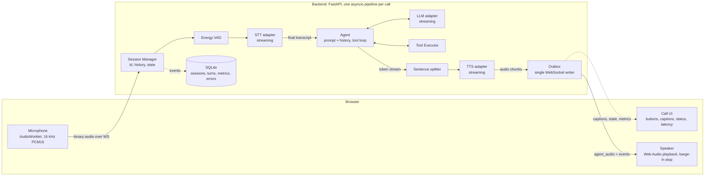
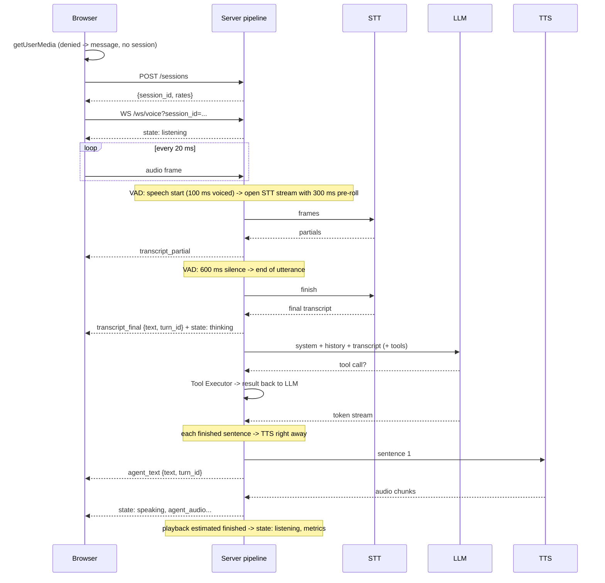
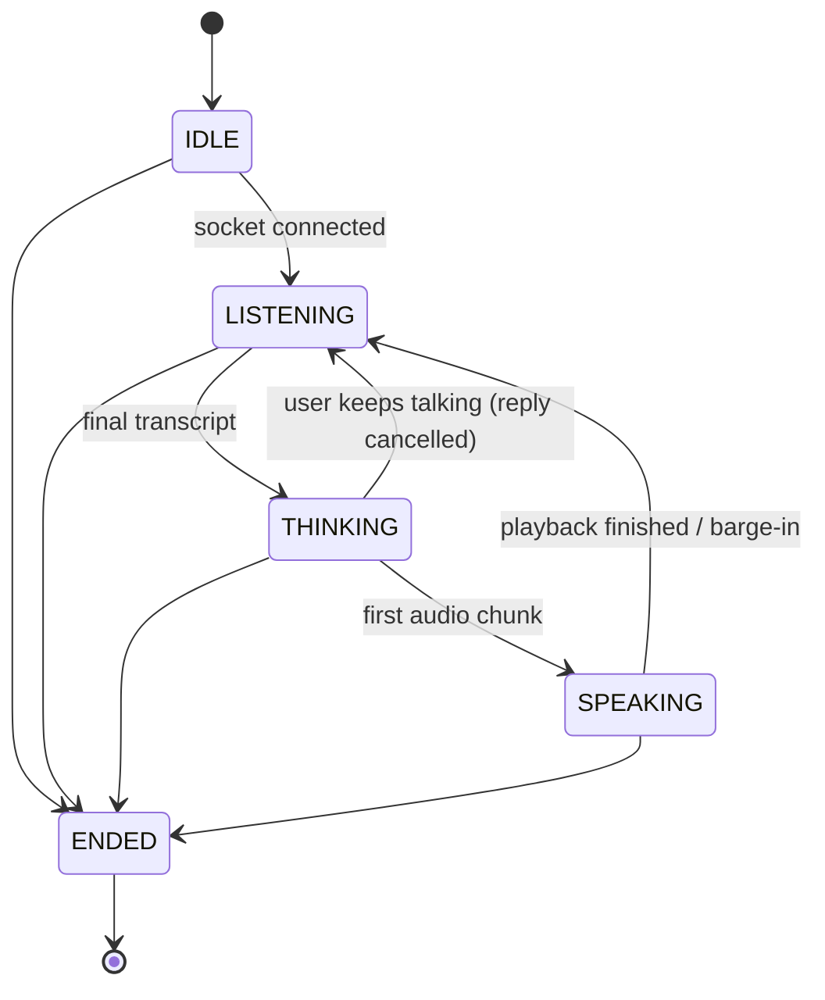

# Voice Agent MVP: design

This document covers the call flow, the wire protocol, the provider interfaces,
latency instrumentation, barge-in, error handling and persistence. The README
covers setup and running.

## 1. Goal and constraints

A user opens a web page, clicks **Start Call**, speaks naturally, and hears a
relevant spoken reply within about **1.5 s** of finishing their sentence. Context
carries across turns until **End Call**.

Design rules that follow from that:

- **Stream every stage.** STT emits partials while the user talks; the LLM
  streams tokens; each complete sentence goes to TTS immediately; TTS audio
  streams to the client chunk by chunk.
- **Measure every stage from day one**, per turn, persisted.
- **The pipeline never knows which vendor it calls.** STT, LLM and TTS sit behind
  small interfaces; swapping one is configuration plus one adapter class.
- **Pin the audio format** at every boundary (section 3).

## 2. Architecture



| Module | File | Responsibility |
| --- | --- | --- |
| HTTP / WS endpoints | `voice_agent/main.py` | `POST /sessions`, `GET /sessions/{id}`, `WS /ws/voice`, static client |
| Session manager | `voice_agent/session.py` | create sessions, one socket per session, forget them when they end |
| Call pipeline | `voice_agent/pipeline.py` | per-call orchestration: VAD, utterances, replies, barge-in, timeouts, errors |
| State machine | `voice_agent/state.py` | allowed state transitions |
| VAD | `voice_agent/vad.py` | speech start / end on 20 ms frames |
| Agent | `voice_agent/agent.py` | tool loop, append-only conversation history |
| Sentence splitter | `voice_agent/sentences.py` | token stream -> speakable sentences |
| Tools | `voice_agent/tools.py` | argument validation, timeouts, sample tools |
| Providers | `voice_agent/providers/` | interfaces (`base.py`), registry, Deepgram, Anthropic, ElevenLabs, mocks |
| Metrics | `voice_agent/metrics.py` | per-turn timer, median / p90 |
| Store | `voice_agent/store.py` | SQLite persistence |
| Web client | `web/` | mic capture worklet, playback, captions, status, barge-in |

## 3. Audio format (pinned)

| Leg | Format |
| --- | --- |
| Client -> server | PCM16 little-endian, mono, **16 kHz**, **20 ms frames** (640 bytes). The AudioWorklet downsamples from the device rate. The server re-frames whatever it receives, so frame size is not load-bearing. |
| Server -> STT | the same frames, unchanged (`encoding=linear16&sample_rate=16000`) |
| TTS -> server | PCM16 LE mono at `TTS_SAMPLE_RATE` (default **24 kHz**), raw (no container) |
| Server -> client | binary frame: `uint32 LE turn_id` + PCM16 LE mono at `output_sample_rate` |

`POST /sessions` returns `input_sample_rate`, `frame_ms` and `output_sample_rate`,
so the client never hard-codes them. The 4-byte turn id on each audio frame lets
the client drop audio from a reply it already interrupted, with no race against
JSON events.

## 4. Call flow



Step by step, matching the spec:

1. **Start call.** The client asks for the microphone *first*, so a denial never
   creates a session. Then `POST /sessions`, open the WebSocket, start streaming.
   State -> LISTENING.
2. **Listen.** The VAD runs on every frame. A segment starts after 100 ms of
   voiced frames, so clicks and taps never start one. Its frames, plus 300 ms of
   pre-roll, go to a new streaming STT session.
3. **Transcribe.** Partials go out as `transcript_partial`. After 600 ms of
   silence the VAD ends the utterance; segments with under 250 ms of voice are
   dropped, as are empty transcripts. Neither ever reaches the LLM. Otherwise the
   final transcript goes out as `transcript_final`. State -> THINKING.
4. **Think.** The transcript is appended to the history and the LLM is called
   with the system prompt, history and tools. Tool calls run in the Tool
   Executor and their results go back to the LLM; tokens stream throughout.
5. **Speak.** Tokens are buffered into sentences; each complete sentence goes to
   TTS immediately, its text as `agent_text`, its audio as `agent_audio`. State
   -> SPEAKING on the first audio chunk.
6. **Barge-in.** See section 8.
7. **Next turn.** The server tracks how much audio it has sent and when, and
   returns to LISTENING once the client should have finished playing it (plus
   250 ms of slack).
8. **End call.** End Call (`end_call`), 2 minutes of silence, the maximum call
   duration, or a dropped socket. Timeouts say a short goodbye first. The server
   sends `call_ended {reason}`, closes the socket and marks the session ended.
   Turns and metrics are already persisted as they happen.

## 5. Session state machine



`state.py` enforces this table and raises on anything else; the unit tests
cover every edge. Fallback lines and goodbyes go through THINKING -> SPEAKING
like any other reply.

## 6. API and WebSocket events

REST:

| Endpoint | Response |
| --- | --- |
| `POST /sessions` | `201 {session_id, input_sample_rate, frame_ms, output_sample_rate}` |
| `GET /sessions/{id}` | `{session, transcript[], metrics[], errors[]}`; 404 if unknown |
| `GET /healthz` | `{status, providers, active_sessions}` |

WebSocket `/ws/voice?session_id=...`. Binary frames carry audio; text frames carry
JSON objects with a `type` field.

| Event | Direction | Payload | Purpose |
| --- | --- | --- | --- |
| audio (binary) | client -> server | PCM16 16 kHz mono frames | user speech |
| `interrupt` | client -> server | `{turn_id, played_ms?}` | barge-in; `played_ms` = how much of that turn the user heard |
| `end_call` | client -> server | `{}` | End Call button |
| `ping` | client -> server | `{}` | answered with `pong` |
| `state` | server -> client | `{state}` | `listening` / `thinking` / `speaking` |
| `transcript_partial` | server -> client | `{text}` | live captions |
| `transcript_final` | server -> client | `{text, turn_id}` | committed user turn |
| `agent_text` | server -> client | `{text, turn_id}` | agent caption, one sentence at a time |
| agent_audio (binary) | server -> client | `uint32 turn_id` + PCM16 | agent speech |
| `tool_call` | server -> client | `{turn_id, name, arguments}` | shown in the transcript |
| `tool_result` | server -> client | `{turn_id, name, is_error, result}` | shown in the transcript |
| `metrics` | server -> client | `{turn_id, vad_end_ms, stt_final_ms, llm_first_token_ms, tts_first_audio_ms, total_ms}` | latency panel |
| `error` | server -> client | `{code, message, stage?}` | recoverable error |
| `call_ended` | server -> client | `{reason}` | `user_ended` / `silence_timeout` / `max_duration` / `disconnected` |

`end_call`, `ping`, `tool_call`, `tool_result`, `metrics` and the optional
`played_ms` are additions to the spec's event list; nothing in the spec's list
changed meaning. A `turn_id` is an integer shared by a user utterance and the
agent reply to it.

## 7. Provider interfaces

```python
class STTProvider(ABC):
    async def open_stream(self, *, sample_rate: int, on_partial) -> STTStream: ...

class STTStream(ABC):
    async def send(self, pcm: bytes) -> None: ...
    async def finish(self) -> str: ...        # end of audio -> final transcript
    async def aclose(self) -> None: ...

class LLMProvider(ABC):
    def stream(self, *, system, messages, tools) -> AsyncIterator[TextDelta | LLMTurnEnd]: ...

class TTSProvider(ABC):
    sample_rate: int
    def synthesize(self, text: str) -> AsyncIterator[bytes]: ...   # PCM16 chunks
```

Closing an LLM or TTS iterator early cancels the request; that is how barge-in
stops in-flight work. Messages are provider-neutral `ChatMessage`s; an assistant
turn also keeps the provider's own content (`native`), which the same provider
replays verbatim.

Providers are chosen by `STT_PROVIDER`, `LLM_PROVIDER` and `TTS_PROVIDER`.
Built-ins register by name (`registry.py`); a custom adapter needs no registration
at all, since `TTS_PROVIDER=my_pkg.tts:MyTTS` imports the class and builds it from
`Settings`. Built-in adapters:

| Stage | Adapters |
| --- | --- |
| STT | `deepgram` (live WebSocket, nova-3, interim results; one stream per utterance), `mock` |
| LLM | `anthropic` (Claude, streaming + tool use), `mock` (rule-based, with tools and memory) |
| TTS | `deepgram` (Aura, streamed linear16), `elevenlabs` (streamed PCM), `mock` |

## 8. Barge-in

1. **Client detection.** While agent audio is playing, the client checks the
   level of each mic frame (after the browser's echo cancellation). Over -38 dBFS
   for 160 ms counts as the user talking. It stops all scheduled audio at once,
   drops any further audio for that turn id, and sends
   `interrupt {turn_id, played_ms}`.
2. **Server side.** The reply task is cancelled. That closes the LLM stream and
   the TTS stream, so the requests stop. Queued audio for the turn is dropped.
   State -> LISTENING.
3. **The interrupting words aren't lost.** The VAD never stops running, and the
   current speech segment's frames are buffered. Entering LISTENING while speech
   is in progress opens an STT stream seeded with that segment.
4. **What was heard goes into history.** Each sentence's position in the reply's
   audio is recorded (`timeline.py`). From `played_ms`, the server keeps the fully
   heard sentences plus the heard share of the cut-off one, ending in "...". That
   text, not the full generated reply, becomes the assistant turn. The DB row is
   marked `interrupted`.
5. **Talking while the agent thinks.** If the user keeps talking for 200 ms after
   their turn was committed but before any reply audio, the reply is cancelled
   and the new speech is appended as a further user turn. "What time is it...
   in Tokyo?" is answered as one question.
6. **Echo.** Speech the server hears while SPEAKING, without an `interrupt` from
   the client, is discarded rather than transcribed.

The stop time is about 160 ms of detection plus one audio callback. That is
within the 300 ms target, and it doesn't depend on the network, because
playback stops on the client.

## 9. Conversation history and Claude

The history is **append-only**. Round trips that end in tool calls are committed
as soon as the model returns them, since the next request needs them. The final
round of a reply is held back until the server knows what the caller heard:

- played to the end -> committed exactly as generated (thinking blocks included);
- interrupted -> only the heard text is committed, as plain text.

Nothing already sent to the API is ever edited, the system prompt and tool list
are fixed for the whole call, and every interrupted tool call gets a matching
error `tool_result`. This keeps Claude's thinking-block signatures valid and lets
prompt caching (`cache_control`) reuse the prefix on every turn. If the API ever
rejects a history's thinking blocks, the adapter strips them and retries once.

The default model is `claude-opus-5-5` at `effort: low`: voice replies are short,
and time to first token matters most. `LLM_MODEL=claude-haiku-5-5` trades some
quality for lower latency. Server-side refusal fallbacks (`fallbacks: "default"`)
are on by default (`LLM_FALLBACKS=off` disables them) and are skipped for Haiku,
which has none. A refusal is never replayed or executed. Tool inputs stream
eagerly and are validated against the tool's schema before running.

## 10. Latency instrumentation

Every turn records five wall-clock marks on the server's monotonic clock:

| Metric | From | To | Budget |
| --- | --- | --- | --- |
| `vad_end_ms` | last voiced frame received | VAD declares end of utterance | ~600 (the silence wait) |
| `stt_final_ms` | end of utterance | final transcript | ~200 |
| `llm_first_token_ms` | final transcript | first text token of the reply | ~400 |
| `tts_first_audio_ms` | first token | first audio chunk sent to the client | ~250 |
| `total_ms` | last voiced frame | first audio chunk sent | **<= 1500** |

The stages are back to back, so they add up to `total_ms`. When the model speaks
before calling a tool ("Let me check that."), first audio comes from that
sentence, so the tool round trip is hidden. Metrics go to the client
(`metrics` event, shown in the latency panel) and into the `metrics` table.
`scripts/latency_report.py` prints median and p90 per stage over the last N turns.
Not counted: client-to-server network time before the last voiced frame, and the
client's 60 ms jitter buffer.

## 11. Error handling

| Failure | Behaviour | Where |
| --- | --- | --- |
| Mic permission denied | clear message; no session created (mic is requested before `POST /sessions`) | `web/app.js` |
| STT / LLM / TTS error or timeout | `error` event, row in `errors`; agent says "Sorry, I didn't catch that, could you repeat?"; call continues. If TTS itself is down, the line is still shown as a caption. If the LLM fails mid-reply, what was already said stands. | `pipeline.py` |
| WebSocket drops | client shows "Disconnected"; server cancels work, marks the session `disconnected`; turns are already saved | `pipeline.on_disconnect` |
| Empty / noise-only utterance | VAD start threshold, minimum voiced length, empty transcript check; no LLM call | `pipeline._process_frame`, `_finish_utterance` |
| Tool call fails | unknown tool, invalid arguments, exception or timeout become an `is_error` result; the LLM explains it | `tools.py` |
| Max duration / silence timeout | short goodbye, then `call_ended` | `pipeline._watch`, `end` |
| Refusal | short polite line; the refused content is not replayed | `agent.py` |

Timeouts: STT 4 s (end of speech to transcript), LLM 10 s (to first token and
between tokens), TTS 5 s (to first chunk and between chunks), tools 5 s. All are
configurable.

## 12. Persistence

SQLite (`DB_PATH`), written as the call happens:

- `sessions(id, started_at, ended_at, end_reason, config)`. `config` holds the
  providers, model, prompt version (a hash of the prompt unless `PROMPT_VERSION`
  is set), audio and VAD settings. It contains no secrets.
- `turns(session_id, turn_id, role, text, interrupted, tool_calls, created_at)`
- `metrics(session_id, turn_id, vad_end_ms, stt_final_ms, llm_first_token_ms, tts_first_audio_ms, total_ms)`
- `errors(session_id, turn_id, stage, code, message, created_at)`

`GET /sessions/{id}` returns all four for one call.

## 13. Testing

- **Unit:** state machine transitions, VAD (synthetic signals and the recorded
  fixture), sentence splitting, tools, agent tool loop and history rules,
  timeline, metrics, store, config and registry, and each adapter. The adapters
  run against a fake Anthropic client, a local fake Deepgram WebSocket server,
  and mocked HTTP for TTS.
- **Pipeline:** every flow and failure in sections 4, 8 and 11, with mock
  providers and a fake socket.
- **Integration:** `tests/test_integration.py` starts the real server and streams
  `tests/fixtures/two_turns.wav` (two recorded questions with a click between
  them) over a real WebSocket. It checks transcripts, tool calls, audio, metrics
  and the persisted session.
- **Live:** `pytest -m live` runs the Deepgram and Anthropic adapters against the
  real APIs when keys are set.

## 14. Limitations and next steps

- Barge-in detection is energy-based on the client, so it relies on the
  browser's echo cancellation. Headphones make it most reliable; a server-side
  check with a model VAD (e.g. Silero) would be the next step.
- The VAD is energy-based. It is fine for a quiet room; a neural VAD would cope
  better with noise.
- The server estimates when playback ends. A `playback_done` event from the
  client would make the LISTENING transition exact.
- One process, in-memory live sessions; horizontal scaling, auth and telephony
  are out of scope, per the spec.
